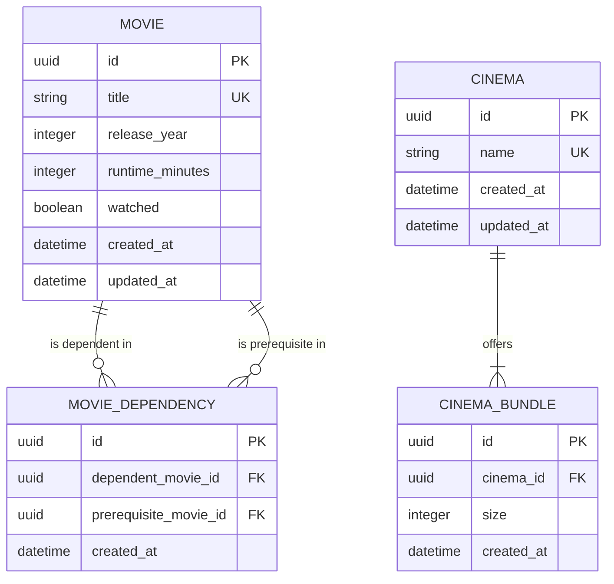

# Doomsday Ready

A full-stack MCU rewatch planner and cinema bundle booking optimizer. The application lets users manage movies and prerequisite relationships, generate a prerequisite-first rewatch plan, and calculate the minimum number of cinema bundles needed to seat a group exactly.

## Features

### Movie collection and prerequisites

- Create and list movies, and update movie details or watched status.
- Movie titles are unique without regard to letter case.
- Runtime is constrained to 1–300 minutes; release year must be a positive integer.
- A movie can have zero or more prerequisites. A prerequisite must be watched before its dependent movie.
- Prerequisite lists can be replaced later. Omitting `prerequisites` from a PATCH leaves existing relationships unchanged; sending an empty list removes them.
- Direct and indirect cycles are rejected with HTTP `409` and code `CIRCULAR_DEPENDENCY`.

### Rewatch plan

- Returns every direct and transitive prerequisite of the selected target exactly once.
- The target itself is excluded.
- Uses a deterministic topological order with prerequisites before dependent movies.
- Reports the number of prerequisites, how many are already watched, and the combined runtime of unwatched prerequisites.

### Cinema booking

- Create and list cinemas with 1–10 distinct bundle sizes per cinema.
- Each bundle size is between 1 and 500 seats.
- For a requested group size from 1 to 10,000, find an exact allocation using the fewest bundles.
- Returns an explicit impossible result when no exact allocation exists.

### Frontend

The React interface provides three main views: Movies, Rewatch Plan, and Booking. It includes movie creation/editing, prerequisite management, watched-state controls, rewatch progress, and live booking quotes.

## Technology

- **Backend:** Python 3.11, Django 5.2, Django REST Framework, drf-spectacular
- **Database:** PostgreSQL 17
- **Frontend:** React, TypeScript, Vite, Tailwind CSS, TanStack Query
- **Deployment:** Docker Compose, Gunicorn, Nginx

## Run the complete application with Docker

Prerequisites: Docker Desktop (or Docker Engine) with the Docker Compose plugin.

1. Clone the repository and enter its root directory.
2. Create your local environment file:

   ```bash
   cp .env.example .env
   ```

3. Replace `POSTGRES_PASSWORD` and `DJANGO_SECRET_KEY` in `.env` with strong local values. Keep `.env` private; it is ignored by Git.
4. Build and start the database, API, and frontend:

   ```bash
   docker compose up --build
   ```

5. Open the application and API documentation:

   - Frontend: <http://127.0.0.1:5173>
   - API health: <http://127.0.0.1:8000/api/health/>
   - Swagger UI: <http://127.0.0.1:8000/api/docs/>
   - OpenAPI schema: <http://127.0.0.1:8000/api/schema/>

The backend container waits for PostgreSQL to become healthy, applies migrations, and starts Gunicorn. The frontend container serves the built React application through Nginx. The database data is persisted in the `postgres_data` Docker volume. This Compose setup is intended for local assessment/demo use; before any public deployment, set `DJANGO_DEBUG=False`, use a secure secret, configure production hosts/origins, and terminate HTTPS at a production web server or load balancer.

Stop the services with:

```bash
docker compose down
```

To remove the database volume as well (this permanently deletes the local database data):

```bash
docker compose down -v
```

## Run services locally for development

The root `.env` file is also read by Django and Vite. The example uses host port `5434` for PostgreSQL because Docker maps `127.0.0.1:5434` to the database container's port `5432`.

### 1. Start PostgreSQL

```bash
cp .env.example .env
docker compose up -d db
```

### 2. Start the backend

In a new terminal:

```bash
cd backend
python3 -m venv .venv
source .venv/bin/activate
pip install -r requirements.txt
python manage.py migrate
python manage.py runserver 127.0.0.1:8000
```

The backend reads `POSTGRES_HOST=localhost` and `POSTGRES_PORT=5434` from the root `.env` file.

### 3. Start the frontend

In another terminal:

```bash
cd frontend
npm ci
npm run dev
```

The Vite configuration loads environment variables from the repository root. `VITE_API_BASE_URL` should be `http://127.0.0.1:8000/api` for this local setup.

## API reference

Interactive request/response schemas are available at `/api/docs/` when the backend is running.

| Method | Endpoint | Purpose |
|---|---|---|
| `GET` | `/api/movies/` | List movies |
| `POST` | `/api/movies/` | Create a movie |
| `PATCH` | `/api/movies/{id}/` | Update movie fields, watched status, or prerequisites |
| `GET` | `/api/movies/{id}/rewatch-order/` | Build the prerequisite rewatch plan |
| `GET` | `/api/cinemas/` | List cinemas and their bundle sizes |
| `POST` | `/api/cinemas/` | Create a cinema |
| `GET` | `/api/cinemas/{id}/booking/?groupSize={n}` | Calculate an exact minimum-bundle booking |
| `GET` | `/api/health/` | Health check |
| `GET` | `/api/schema/` | OpenAPI schema |
| `GET` | `/api/docs/` | Swagger UI |

### Create a movie

`POST /api/movies/`

```json
{
  "title": "The Avengers",
  "release_year": 2012,
  "runtime_minutes": 143,
  "watched": false,
  "prerequisites": []
}
```

`prerequisites` is an optional array of existing movie UUIDs. The relation direction is **dependent movie → prerequisite movie**. For example, if The Avengers requires Iron Man, The Avengers' prerequisite list contains Iron Man's UUID.

A circular relationship returns HTTP `409`:

```json
{
  "code": "CIRCULAR_DEPENDENCY",
  "detail": "This prerequisite would create a circular dependency."
}
```

### Create a cinema

`POST /api/cinemas/`

```json
{
  "name": "City Multiplex",
  "bundle_sizes": [2, 5, 8]
}
```

### Request a booking quote

`GET /api/cinemas/{id}/booking/?groupSize=11`

For bundle sizes `[2, 5]` and a group of 11, one optimal response is:

```json
{
  "possible": true,
  "group_size": 11,
  "total_bundles": 4,
  "bundles": [
    {"size": 5, "count": 1},
    {"size": 2, "count": 3}
  ]
}
```

For bundle sizes `[4, 6]` and a group of 7, `possible` is `false`, `total_bundles` is `null`, and `bundles` is an empty array.

## Algorithm and design notes

### Dependency graph validation

The movie prerequisite relation is a directed graph. Before replacing a movie's prerequisite edges, the service builds the proposed graph and checks it with Kahn's topological-processing method. A graph is cyclic when not all vertices can be processed. This validation is `O(V + E)` in the number of movies and dependency edges.

All prerequisite mutations acquire the same PostgreSQL transaction-level advisory lock. The lock is acquired **before** locking an individual movie row. This consistent lock order serializes graph updates and avoids the row-lock/advisory-lock inversion that could deadlock concurrent dependency changes. The validation and edge replacement occur in one database transaction, so a rejected cycle leaves the previous graph unchanged.

### Rewatch ordering

The service first finds the target's transitive prerequisite closure with iterative depth-first search. It then applies Kahn's topological sort to that subgraph. A min-heap using case-folded title and movie ID as tie-breakers makes the result deterministic.

For a relevant subgraph with `V` movies and `E` dependency edges, the ordering algorithm is `O(V + E + V log V)` time and `O(V + E)` space. The service currently loads the movie and dependency tables in two bulk queries before selecting the target's reachable subgraph; this is appropriate for the assessment-sized dataset and avoids N+1 queries.

### Cinema bundle optimization

The booking problem is an unbounded minimum coin-change problem: every configured bundle size may be used repeatedly. Dynamic programming computes the minimum bundle count for each seat total from `1` through the requested group size. A predecessor array reconstructs the selected bundle counts.

Let `G` be the requested group size and `B` the number of available bundle sizes. Time complexity is `O(G × B)` and auxiliary space complexity is `O(G)`. The constraints cap `G` at 10,000 and `B` at 10.

## Data model



`MOVIE_DEPENDENCY` is a directed self-referential join table: both foreign keys point to `MOVIE`, but have different meanings. The pair `(dependent_movie_id, prerequisite_movie_id)` is unique, and self-dependencies are prohibited at the database level. `CINEMA_BUNDLE` stores one distinct bundle size per cinema.

## Validation and tests

Run backend checks from the `backend` directory with the virtual environment activated:

```bash
python manage.py check
python manage.py test apps.movies apps.cinemas
python manage.py spectacular --file /tmp/doomsday-openapi.yml --validate
```

Run frontend checks from the `frontend` directory:

```bash
npm run lint
npm run build
```

Run Docker configuration/build checks from the repository root:

```bash
docker compose config
docker compose up --build
```

## Assumptions

- A prerequisite is a movie that must be watched before its dependent movie.
- The rewatch plan includes all direct and indirect prerequisites, each once, but excludes the selected target movie.
- Watched count and remaining runtime are calculated over prerequisites only. Remaining runtime includes only unwatched prerequisite movies.
- Movie release year is a positive integer; the 1–300 minute limit applies to runtime.
- Cinema bundle sizes may be reused without a per-size quantity limit. The optimizer must find an exact seat total and minimize the number of bundles; it does not sell individual seats outside the configured bundles.
- No official MCU chronological guide is bundled. The database's prerequisite relationships are editable sample data supplied for demonstrating the graph feature.

## AI assistance disclosure

ChatGPT and Claude were used as development assistants for design discussion, code review, debugging, and documentation support. Their suggestions were reviewed and adapted during implementation; the project owner is responsible for the final code and for running the verification commands above.
